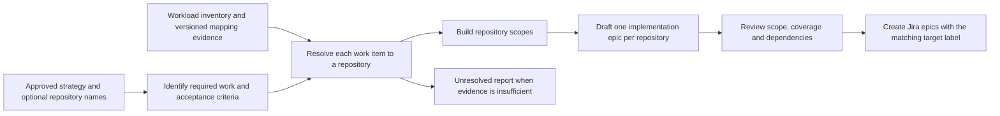

# Create Epic Creator epics around repository boundaries

**Status:** Proposed implementation design; no runtime changes or new evaluation runs.
**Date:** 2026-11-02
**Delivery:** AISDLC-547 under AISDLC-90; producer contract coordinated with AISDLC-548.

## Required outcome

Epic Creator must determine the repository scopes before writing implementation
epics. Each implementation epic must describe work and acceptance criteria that
can be implemented through changes in exactly one approved contribution repository.
Attaching a repository label to an already generated component-oriented epic does
not meet this requirement.

The input remains an approved strategy obtained from Jira, including its accepted
attachment or description, requirements, acceptance criteria and SME input.
Repository names are optional. Whenever supplied, use them as explicit scope input,
canonicalize them and validate them against the selected workload's contribution
inventory. Missing names do not prevent resolution from configured evidence.
Contradictory names or unsupported contribution destinations produce an explicit
unresolved result rather than an invented assignment.



## Boundary policy

For the initial implementation, use one implementation epic per canonical
repository per input strategy and effective conditional scenario. This is the
planning choice for this version, consistent with the user's operator example.
Separate strategies can create separate epics in the same repository.

- Manager controllers, cloudmanager controllers, tests, lint and required guidance
  in the same operator repository belong to one operator implementation epic.
- Dashboard and operator changes belong to two implementation epics. Each has its
  own scope, tests and acceptance criteria; genuine interface dependencies remain.
- Required guidance belongs to the operator epic if published there. If its
  approved publication destination is another repository, create that repository's
  epic. Unknown publication destination remains unresolved. Historical ADR PRs do
  not establish an extra requirement in the strategy.
- Component, team, subsystem, priority, work-product type and epic size do not
  override repository boundaries. Preserve component/team ownership, priority and
  delivery order on work items and sections inside the repository epic. Subsequent
  story decomposition can subdivide work within it.
- A genuine investigation can remain an Investigation epic without an
  implementation target. Do not disguise unresolved implementation destinations
  as resolved investigations, or drop implementation work to make coverage pass.
- Do not create a separate code and documentation epic for the same repository.
  Mixed code/docs epics retain documentation accuracy checks. Preserve the existing
  single `implementation_type` only for homogeneous scopes; mixed scopes use the
  normal implementation route and describe specialized work in their work items.
- Conditional plans keep the existing branch publication behavior. For each
  effective scenario (shared work plus one selected branch), a repository occurs
  in at most one implementation epic. Put same-target conditional acceptance
  criteria inside the shared repository epic where possible; otherwise retain
  mutually exclusive branch plans. Never publish all alternatives as active epics.

Repo-local implementation ACs may reference external APIs, artifacts or an
integration environment. They must not require this epic to modify a second
repository. Preserve strategy-wide integration acceptance and traceability in the
summary and link the participating repository deliverables; never delete an AC
merely because its verification spans repositories.

## Configuration and evidence

The user authorized implementation on a separate feature branch from PR #40's
verified head, superseding the earlier wait-for-merge requirement. Build on its
workload descriptors without changing PR #40's branch.
Shared Python validation and shared
planning/review prompts implement the behavior. Domain-specific inventories,
evidence sources and source precedence live in workload data, without hardcoded
RHAI repository names or a requirement for an Architecture Context repository.

Add optional `planning.repository_policy` with:

- `mode: one-implementation-epic-per-repository`;
- an approved inventory, referenced by source ID and file path;
- source entries declaring stable ID, owner, authoritative/supporting role,
  Git repository URL or document link, requested ref and selected files/directories.

The user confirmed configuration must accept links to repositories/documents and
that the first implementation may assume all source files live in accessible Git
repositories. The producer fetches these configured sources automatically; callers
do not have to prepare local snapshots. Accept a repository URL with `ref` and
`paths`, or a Git-hosted file/directory link normalized to those same fields. Use
an explicit ref when a link's branch/path boundary is ambiguous. Support Markdown,
YAML and JSON sources through the same Git retrieval path.

At run start, resolve each configured ref to a commit SHA, fetch the selected
content and record source URL, requested ref, resolved SHA, paths and file digests.
Local snapshots are the resulting runtime cache. Reuse the authorized Git
credential mechanism and architecture bootstrap where applicable, without exposing
credentials to agents or logs. Before resume/submission, refresh source refs and
compare their resolved SHAs and manifests to the bound snapshot. A changed source
requires replanning and fresh review; never combine revisions within a run.
An explicit commit ref remains pinned, subject to the workload freshness policy.
Unreachable repos or missing paths yield an explicit unavailable-source result.

For RHAI, configure both the repository mapping document's Git location and the
Architecture Context repository. They are evidence sources; their Git locations
are not automatically implementation targets. The existing mapping reference is
a Google Doc: the agreed Git-accessibility assumption requires a maintained Git
copy/location before activation. This plan does not claim that copy already exists
or move the document. Direct Google Docs retrieval is outside the first version.
No approval is inferred from the current source-review files.

Illustrative configuration; the mapping URL and paths below are placeholders,
not verified RHAI locations:

```yaml
planning:
  repository_policy:
    mode: one-implementation-epic-per-repository
    inventory:
      source_id: repository-mapping
      path: inventory.yaml
    sources:
      - id: repository-mapping
        owner: rhai-mapping-maintainers
        role: authoritative
        url: https://git.example.org/rhai/repository-mapping.git
        ref: main
        paths: [repository-mapping.md, inventory.yaml]
      - id: architecture-context
        owner: rhai-architecture-maintainers
        role: supporting
        url: https://github.com/opendatahub-io/architecture-context.git
        ref: main
        paths: [architecture/rhoai-3.5-ea.2, overlays]
```

Actual owners, source precedence, release paths and freshness policy are verified
as part of workload preparation. Use strategy-appropriate release context rather
than assuming the illustrative architecture version applies to every strategy.

An inventory entry supplies an inventory key, canonical provider/host/namespace/
repository identity, its unique `target-repo-<inventory-key>` label, and contribution
approval reference. Upstream/downstream/fork aliases require explicit inventory
relationships. A product repository is not automatically the contribution target.

The mapping snapshot binds workload ID/version/digests, source strategy content
and provenance, normalized explicit repository inputs, inventory content/revision,
source roles, Git URLs/resolved SHAs, content digests and freshness information.
Review, resume
and submission must use the same binding. Changes invalidate the plan and review.
Missing, expired, conflicting or unavailable required evidence yields unresolved;
there is no default or first-candidate target. Allowlisting alone cannot establish
that a repository is correct for a particular work item.

## Structured planning contract

Create these artifacts before any implementation epic files:

- `artifacts/repository-plans/{ID}-context.json`: frozen input/evidence binding;
- `artifacts/repository-plans/{ID}-proposal.json`: required work items and proposed
  assignments, produced by the shared repository-planning agent;
- `artifacts/repository-plans/{ID}.json`: validated, deterministically grouped
  repository scopes and explicit unresolved items.

Each work item contains a stable ID, source requirement and acceptance references,
concrete change description, kind (`implementation` or `investigation`), delivery
type, priority, ownership and dependencies. Implementation resolution is either
one inventory target with evidence references, or unresolved with reason,
candidates and available evidence. Requirements spanning repositories become
multiple concrete work items sharing the source requirement reference.

Finalization groups resolved implementation items by canonical target, retaining
their individual ACs, priorities and provenance. It rewrites inter-item dependencies
as inter-scope dependencies; dependencies inside a repository become internal
sequencing rather than epic self-links. If grouping creates a genuine cross-repo
dependency cycle, report `repository_dependency_cycle` and block submission rather
than deleting edges or silently changing the boundary policy.

Each Implementation epic carries `repository_scope`, `work_item_ids`, one canonical
`target_repository` object and `mapping_snapshot_digest`. The target object contains
`inventory_key`, `provider`, `host`, `namespace` and `repository`, and must match
its inventory entry exactly. Add a `components` array for all affected canonical
Jira components while retaining `component` as the primary compatibility field.
The primary field is the first member of the ordered, deduplicated list.

Review binds both the repository plan and the complete reviewed decomposition.
Deterministic checks establish identity, assignment, coverage references,
uniqueness and provenance. The reviewer also evaluates whether the actual scope
and AC text fit the assigned repository and preserve source intent. A list of
correct IDs alone is insufficient semantic evidence.

## Pipeline and publication

Add a real `PLAN_REPOSITORIES` phase between FETCH and DECOMPOSE. It prepares
context, runs the shared planner and finalizes its proposal. DECOMPOSE cannot run
before a valid repository plan exists. Decomposition drafts from its scopes;
review and revision cannot revert to component-based boundaries.

For the first release, any unresolved required implementation destination blocks
publication of that strategy's generated epics. Persist a useful planning report,
including candidates and missing evidence. Other strategies in a batch continue.
Normal resolved runs remain automatic; owner verification is development and
configuration work, not a manual approval step on every run.

Create each resolved Implementation epic in Jira with exactly its inventory label
in the initial create request, alongside unrelated workflow labels. Include the
canonical target and evidence in the published artifact/description. Preflight all
epics before the first write. Recovery must check actual labels and content against
the reviewed plan and preserve the existing ambiguous-create journal behavior.
An old epic missing the target must fail recovery rather than silently dispatch.

Both explicit-workload and default RHAISTRAT entry points must enforce this policy
when their registered workload enables it. Existing historical artifacts remain
readable but must be regenerated and reviewed before repository-mode submission.
No automatic relabeling or restructuring of existing Jira issues is included.

## Acceptance and limits

The feature is complete only when a fresh pipeline run produces repository-oriented
epics from the original strategy input. The original RHAISTRAT-2417 baseline is
negative evidence: five drafts, zero structured targets, and manager/cloudmanager
in separate epics. PR #40 inspection was not a planning run.

Required proof includes deterministic contract tests, wire-level mocked Jira tests,
fresh model decomposition/review runs for the operator and dashboard/operator
cases, and at least one owner-verified real non-RHAI workload with a different
source structure. A synthetic alternate-workload test proves configuration
isolation, not real domain acceptance. Do not assert a fixed total number of epics
for RHAISTRAT-2417 before investigation needs and publication destination are
verified; require the single operator implementation epic and complete coverage.

AISDLC-546 supplies verified sources/inventory and expected answers; AISDLC-547
implements this producer; AISDLC-548 consumes its target contract; AISDLC-549
maintains evaluation automation. AISDLC-4 deployment and live Fullsend consumer
changes are outside this implementation plan. No Jira mutations, source-policy
approvals, deployment or model runs are performed by writing this design.

## Inspected baselines

- [Current main, `6bc909c`](https://github.com/fullsend-ai/epic-creator/tree/6bc909c9617fc0e6ea4f604307d8fc06df90adb2): no structured target assignment or repository-based epic invariant.
- [PR #40](https://github.com/fullsend-ai/epic-creator/pull/40), open at `424bffd790afa96a91244654a59f4c3d11800307`: descriptor-driven planning/submission, used as the integration foundation.
- [Proposed ADR in PR #45](https://github.com/fullsend-ai/epic-creator/blob/6e6b32a7fd24cfedb7c3d14df671933147f9f5f7/docs/ADRs/0002-target-repository-mapping.md): useful proposed mapping contract; not an accepted or implemented design. This design makes creation-time repository boundaries explicit.

The selected approach adds a pipeline phase and deterministic scope contract;
prompt-only instructions would not enforce ordering or block an unchanged reviewer
from splitting the same repository again. This is an implementation recommendation.
